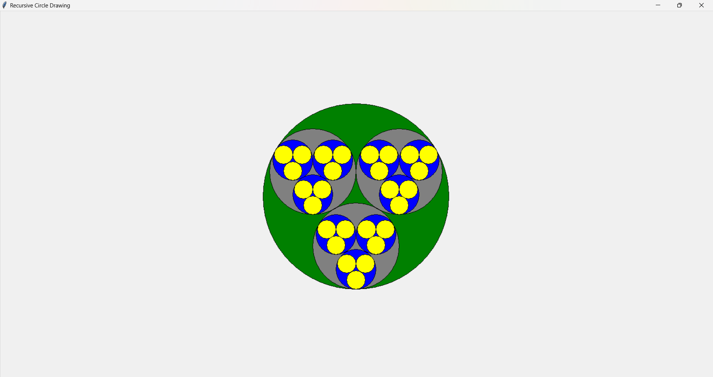

# Recursion

Requirements

1. You need a `Circle` class with properties like coordinates of the origin, radius, color and something fun that comes to your mind.
2. The color for the circles are the same fore the same depth but different from other depths. Eg. depth 0: the big circle is red. depth 1: the 3 small circles are green. depth 2: the 9 small circles are white.
3. (Extra credit) Add the time library and pause for a small amount of time after drawing each circle, so that it becomes an animation.

The following is the sample code to draw a circle:

~~~py
import tkinter as tk

# Create an instance of tkinter frame
root = tk.Tk()

# Title the window
root.title("Recursive Circle Drawing")

# Create a canvas object
canvas = tk.Canvas(root, width=800, height=800)
canvas.pack()

# Draw an Circle in the canvas
canvas.create_oval(top_left_x, top_left_y, bottom_right_x, bottom_right_y, fill="Red")
root.mainloop()
~~~

The running result is like below:

